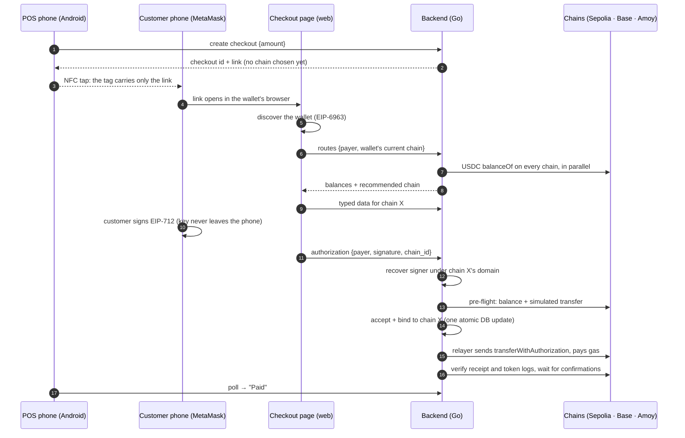

# Tap-to-pay USDC checkout

**Tap your phone on a POS terminal, sign once in your wallet, and pay in USDC with no gas, no app install
and no private keys crossing the counter.**

This is a hands-on learning project: a chain-agnostic, gas-sponsored USDC payment flow for EVM chains, built
from the NFC tag up to on-chain settlement. It runs on **testnets only** (Ethereum Sepolia, Base Sepolia and
Polygon Amoy) and handles no real funds.

> First real testnet payment: 0.01 USDC on Sepolia, paid by a customer who held **no ETH**. The relayer paid
> the gas.
> [`0xd4bab3…965ba`](https://sepolia.etherscan.io/tx/0xd4bab3d63a3dc2c1822ab0c76e74f545588b405c6276ef64ee1c3094030965ba)

## Why I built it

I've worked with stablecoin payments and custody infrastructure for over a year. One question kept bothering
me: *if anyone can run a node and hold their own keys, why does payments need custody at all?* The best way to
answer it was to build the payment flow myself. Settling a payment turned out to be the easy part. The hard
part is making the whole experience work end to end, reliably: wallets, chains, signatures, gas, finality
and failure recovery. It's the job of a payment **facilitator**, in the same spirit as an
[x402](https://www.x402.org/) facilitator.

## How a payment works



1. **Only a link crosses NFC.** The POS phone pretends to be an NFC tag (Android host card emulation of an
   NFC Forum Type 4 / NDEF tag) holding the checkout URL. No keys, no contract, no transaction. The
   customer's phone needs no app: the link opens the checkout page inside MetaMask.
2. **Wallet discovery.** The page finds the wallet over EIP-6963, so another extension can't hijack
   `window.ethereum`.
3. **Chain selection.** The backend reads the payer's USDC on every enabled chain and recommends one:
   *the customer's preferred chain (or the one their wallet is already on) if it holds enough; otherwise the
   cheapest chain for the relayer that does.* An RPC that doesn't answer shows the balance as *unknown*, not
   zero.
4. **Authorization, not a transaction.** The customer signs an
   [EIP-3009](https://eips.ethereum.org/EIPS/eip-3009) `TransferWithAuthorization` as
   [EIP-712](https://eips.ethereum.org/EIPS/eip-712) typed data. Every field (amount, merchant, nonce, validity
   window) comes from the server's database, never from the request.
5. **Gasless execution.** The backend verifies the signature, simulates the transfer, then its relayer
   submits it and pays the gas. The customer needs only USDC.
6. **Verified settlement.** A payment counts as `confirmed` only when the receipt succeeded *and* the USDC
   contract itself emitted `AuthorizationUsed(payer, nonce)` and `Transfer(payer, merchant, amount)`.

## Design decisions I found interesting

- **A signature can't cross chains.** The EIP-712 domain commits to `chainId` and the token contract. A
  Sepolia signature checked under Base's domain doesn't fail with an error: ECDSA recovery quietly returns a
  *stranger's* address. So every checkout is verified under its own chain's domain, and a test proves the
  stranger case.
- **Late binding.** The merchant doesn't pick the chain. It is fixed only when the customer's signature
  wins, in the same atomic `UPDATE … WHERE status = 'pending'` that accepts it. Twenty authorizations racing
  on two chains produce exactly one winner (tested against real Postgres).
- **One relayer key, many chains.** The relayer has the same address everywhere, but each chain has its own
  account nonce, gas balance, send lock and finality depth. Chains are reconciled in parallel, so a hung
  Amoy RPC never delays a Sepolia confirmation.
- **Crash-safe reconciler.** Every step is re-derived from the database and the chain, so the reconciler
  recovers from restarts, dropped transactions and front-running (someone else submitting the signature
  first). A checkout nobody authorized is searched for on **every** chain before it may expire.
- **Honest UX finding.** MetaMask flags `TransferWithAuthorization` signatures as **high risk**, because
  wallet-drainer phishing uses the same signature type. A real customer sees "deny this" at the moment of
  paying. That pushes towards signing cards or wallet-native payment flows for in-store use.

## Status

| Part | State |
|---|---|
| Gas-sponsored EIP-3009 checkout (Sepolia) | ✅ Working, with a real testnet payment |
| Checkout page: wallet discovery, signing, live status | ✅ Working (pays on the default chain) |
| POS app: amount entry, NFC tag emulation, status screens | ✅ Built. Link → MetaMask handoff verified; physical tap test pending |
| Multi-chain backend: per-chain domain, relayer lanes, chain choice at payment time | ✅ Built, tested on anvil forks of Sepolia + Base and live on 3 testnets |
| Page routing across chains (use the recommendation, one signature) | 🔜 Next |
| Cross-chain settlement (pay on one chain, settle on another) via Circle CCTP / Gateway / Arc | 🔜 Studying |

## What's in this repo

| Folder | What | Stack |
|---|---|---|
| [`backend/`](backend) | Checkout API, EIP-712/3009 verification, chain registry, relayer, reconciler | Go, go-ethereum, Postgres |
| [`web/`](web) | The customer's checkout page | React, TypeScript, Vite, viem |
| [`android-pos/`](android-pos) | The POS phone: takes an amount, emulates the NFC tag, shows the result | Kotlin, Android HCE |

Each folder has its own README with setup steps. The backend's [`docs/notes/`](backend/docs/notes) has my
lesson notes on each concept as I built it.

**Tests:**
- Backend: 159 Go test functions. They cover unit tests, Postgres integration, and end-to-end payments
  against the real USDC contracts on anvil forks of Sepolia and Base Sepolia.
- Web: Vitest.
- Android: JVM tests for the NFC tag state machine and a simulated tap.

## Running it

You need Go, Node, Docker (for Postgres), Foundry (`cast`, `anvil`) and testnet RPC URLs. Then:

```bash
cd backend && cp .env.example .env    # fill in RPC URLs, an API key, the relayer keystore path
docker compose up -d                  # Postgres
set -a; . ./.env; set +a; go run ./cmd/server

cd web && cp .env.example .env.local && npm ci && npm run dev
```

No keys or secrets are committed. Configuration comes from env files that git ignores, and the relayer's
key is an encrypted keystore kept outside the repo.

---

*This is a learning project, published as a snapshot. It is not audited and not for real funds.*
